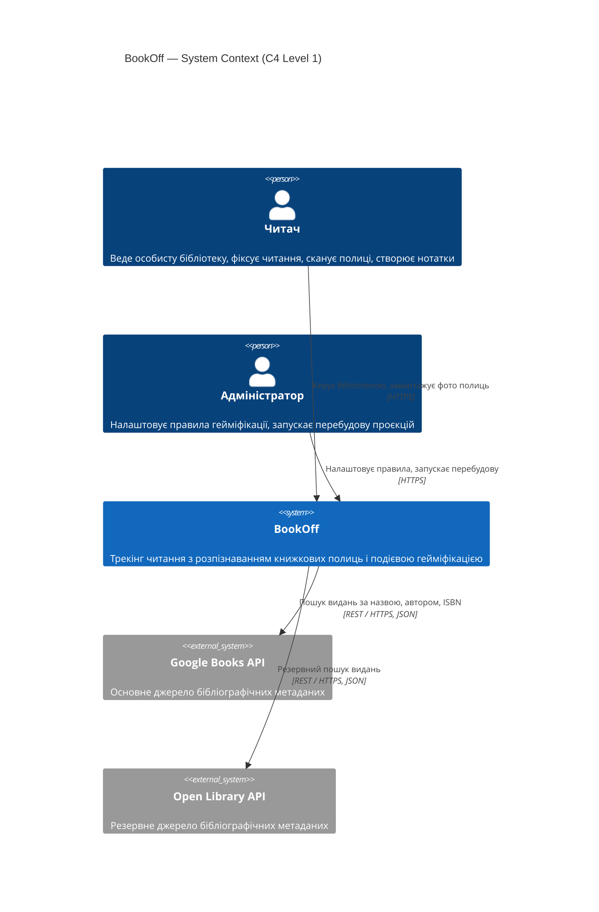

# РОЗДІЛ 2. ПРОЄКТУВАННЯ АРХІТЕКТУРИ СИСТЕМИ

Архітектуру описано за моделлю C4 (Simon Brown) на трьох рівнях: контекст системи, контейнери та компоненти критичного контейнера. Діаграми подано у форматі Mermaid.js (Diagrams-as-Code). Вимоги, на які посилаються описи, визначено в [специфікації вимог](srs.md); ключові архітектурні рішення зафіксовано в [ADR](adr/).

## 2.1 Контекстне та контейнерне моделювання системи (C4 Model)

### 2.1.1 Рівень 1. System Context

| Елемент | Тип | Опис | Трасування |
|---|---|---|---|
| Читач | Person | Основний користувач: бібліотека, сесії читання, сканер, нотатки, показники гейміфікації | [SRS-FUN-01…SRS-FUN-23](srs.md#21-модуль-ідентифікація-та-доступ), [SRS-FUN-25](srs.md#srs-fun-25) |
| Адміністратор | Person | Користувач із роллю admin: конфігурація правил нарахування та перебудова проєкцій | [SRS-FUN-24](srs.md#srs-fun-24), [SRS-NFR-SEC-06](srs.md#srs-nfr-sec-06) |
| BookOff | System | Система, що проєктується | [SRS, розділ 1](srs.md#1-system-context-контекст-системи) |
| Google Books API | System_Ext | Основне джерело метаданих; взаємодія REST / HTTPS, відповіді JSON, обмеження добовою квотою | [SRS-FUN-07](srs.md#srs-fun-07), [SRS-NFR-REL-04](srs.md#srs-nfr-rel-04) |
| Open Library API | System_Ext | Резервне джерело метаданих; використовується після розмикання Circuit Breaker | [SRS-NFR-REL-04](srs.md#srs-nfr-rel-04) |

Усі взаємодії користувачів із системою виконуються через HTTPS (TLS 1.2/1.3) відповідно до [SRS-NFR-SEC-07](srs.md#srs-nfr-sec-07).

### 2.1.2 Рівень 2. Container

```mermaid
C4Container
  title BookOff — Container Diagram (C4 Level 2)

  Person(reader, "Читач")
  Person(admin, "Адміністратор")

  System_Boundary(bookoff, "BookOff") {
    Container(spa, "Вебклієнт", "Vue 3, TypeScript, Vite", "SPA: бібліотека, статистика, сканер, нотатки, адміністративний розділ")
    Container(mobile, "Android-клієнт", "Capacitor, Vue 3", "Та сама кодова база в нативній оболонці; камера, декодування штрихкоду")
    Container(proxy, "Reverse Proxy", "Caddy 2", "TLS, HSTS, статичні файли SPA, маршрутизація /api/v1")
    Container(api, "API-застосунок", "Python 3.12, FastAPI", "Модульний моноліт: identity, catalog, scanner, reading, notes, gamification-query")
    Container(relay, "Outbox Relay", "Python", "Вибирає неопубліковані записи outbox і публікує їх у Kafka")
    Container(consumer, "Gamification Consumer", "Python, aiokafka", "Ідемпотентні споживачі подій, оновлення CQRS-проєкцій")
    Container(worker, "Scanner Worker", "Python, Celery, PaddleOCR, RapidFuzz", "Конвеєр розпізнавання корінців і зіставлення з каталогом")
    ContainerDb(pg, "PostgreSQL", "PostgreSQL 16", "Схема на модуль, outbox, проєкції, журнал оброблених подій")
    ContainerDb(redis, "Redis", "Redis 7, ACL", "Брокер Celery, кеш метаданих, Token Bucket, ключі ідемпотентності")
    ContainerQueue(kafka, "Apache Kafka", "Kafka 3.x, KRaft, 1 брокер", "Журнал доменних подій, DLQ-топік")
    ContainerDb(s3, "Сховище зображень", "MinIO, S3 API", "Фото полиць, lifecycle-правило 24 год")
    Container(otel, "OTel Collector", "OpenTelemetry Collector", "Прийом трас і метрик, експорт у Prometheus")
    Container(prom, "Prometheus і Grafana", "Prometheus, Grafana", "Метрики, панелі, сповіщення, Blackbox-перевірки")
  }

  System_Ext(gbooks, "Google Books API")
  System_Ext(olib, "Open Library API")

  Rel(reader, spa, "Використовує", "HTTPS")
  Rel(reader, mobile, "Використовує", "Android")
  Rel(admin, spa, "Адміністративний розділ", "HTTPS")
  Rel(spa, proxy, "Виклики API, JSON", "REST / HTTPS")
  Rel(mobile, proxy, "Виклики API, JSON", "REST / HTTPS")
  Rel(proxy, api, "Проксіювання /api/v1", "HTTP/1.1 / TCP 8000")
  Rel(api, pg, "Транзакції: дані модуля + outbox", "SQL / TCP 5432")
  Rel(api, redis, "Задачі Celery, кеш, ліміти", "RESP / TCP 6379")
  Rel(api, s3, "Запис зображень", "S3 API / HTTP")
  Rel(api, gbooks, "Пошук видань", "REST / HTTPS")
  Rel(api, olib, "Резервний пошук", "REST / HTTPS")
  Rel(worker, redis, "Отримання задач", "RESP / TCP 6379")
  Rel(worker, s3, "Читання зображень", "S3 API / HTTP")
  Rel(worker, pg, "Результати задачі + outbox", "SQL / TCP 5432")
  Rel(worker, gbooks, "Пошук кандидатів", "REST / HTTPS")
  Rel(worker, olib, "Резервний пошук кандидатів", "REST / HTTPS")
  Rel(relay, pg, "Вибірка outbox", "SQL / TCP 5432")
  Rel(relay, kafka, "Публікація подій", "Kafka protocol / TCP 9092")
  Rel(consumer, kafka, "Споживання подій, коміт офсетів", "Kafka protocol / TCP 9092")
  Rel(consumer, pg, "Оновлення проєкцій", "SQL / TCP 5432")
  Rel(api, otel, "Траси, метрики", "OTLP / gRPC 4317")
  Rel(worker, otel, "Траси, метрики", "OTLP / gRPC 4317")
  Rel(consumer, otel, "Траси, метрики", "OTLP / gRPC 4317")
  Rel(prom, otel, "Збір метрик", "HTTP / Prometheus scrape")
  Rel(prom, proxy, "Синтетична перевірка /api/v1/health", "HTTPS")

  UpdateLayoutConfig($c4ShapeInRow="4", $c4BoundaryInRow="1")
```

**Опис контейнерів**

| Контейнер | Технологія | Відповідальність | Трасування |
|---|---|---|---|
| Вебклієнт | Vue 3, TypeScript, Vite | Інтерфейс користувача й адміністратора; виклики REST API | [SRS-FUN-01…SRS-FUN-25](srs.md#2-functional-requirements-функціональні-вимоги) |
| Android-клієнт | Capacitor | Нативна оболонка тієї самої SPA; доступ до камери, декодування EAN-13 на пристрої | [SRS-FUN-10](srs.md#srs-fun-10), [SRS-FUN-14](srs.md#srs-fun-14) |
| Reverse Proxy | Caddy 2 | TLS-термінація з автоматичними сертифікатами, HSTS, CORS, роздавання статичних файлів SPA | [SRS-NFR-SEC-07](srs.md#srs-nfr-sec-07) |
| API-застосунок | Python, FastAPI | Модулі identity, catalog, scanner (прийом зображень і статус задач), reading, notes, gamification (читання проєкцій). Автентифікація JWT, RBAC, Token Bucket, Idempotency-Key. Запис подій у outbox у транзакції модуля | [SRS-FUN-01…SRS-FUN-10](srs.md#srs-fun-01), [SRS-FUN-12…SRS-FUN-25](srs.md#srs-fun-12), [SRS-NFR-SEC-01…SRS-NFR-SEC-06](srs.md#srs-nfr-sec-01), [SRS-NFR-REL-03](srs.md#srs-nfr-rel-03) |
| Outbox Relay | Python | Окремий процес; публікує події з outbox у Kafka з ключем партиціювання `user_id` | [SRS-NFR-REL-02](srs.md#srs-nfr-rel-02), [ADR-001](adr/0001-choice-of-technology.md) |
| Gamification Consumer | Python, aiokafka | Ідемпотентні споживачі: нарахування досвіду, серії, рівні навичок, досягнення, сповіщення; перебудова проєкцій | [SRS-FUN-20…SRS-FUN-25](srs.md#srs-fun-20), [SRS-NFR-PERF-05](srs.md#srs-nfr-perf-05), [SRS-NFR-REL-05](srs.md#srs-nfr-rel-05) |
| Scanner Worker | Celery, PaddleOCR, RapidFuzz | Розпізнавання корінців і формування кандидатів; деталізацію подано в підрозділі [2.2](#diagram-level3) | [SRS-FUN-11](srs.md#srs-fun-11), [SRS-NFR-PERF-04](srs.md#srs-nfr-perf-04), [SRS-NFR-QUAL-01](srs.md#srs-nfr-qual-01) |
| PostgreSQL | PostgreSQL 16 | Окрема схема на модуль; таблиці outbox і оброблених подій; CQRS-проєкції | [SRS-NFR-OPS-02](srs.md#srs-nfr-ops-02) |
| Redis | Redis 7 з ACL | Брокер задач Celery, кеш метаданих (Cache-Aside), лічильники Token Bucket, ключі ідемпотентності з TTL 24 год | [SRS-NFR-PERF-06](srs.md#srs-nfr-perf-06), [SRS-NFR-SEC-05](srs.md#srs-nfr-sec-05) |
| Apache Kafka | Kafka, KRaft, 1 брокер | Журнал доменних подій без обмеження строку зберігання; DLQ-топік | [SRS-NFR-REL-06](srs.md#srs-nfr-rel-06), [ADR-001](adr/0001-choice-of-technology.md) |
| Сховище зображень | MinIO (S3 API) | Тимчасове зберігання фото полиць; автоматичне видалення через 24 год | [SRS-NFR-SEC-08](srs.md#srs-nfr-sec-08) |
| OTel Collector, Prometheus і Grafana | OpenTelemetry, Prometheus, Grafana | Збір трас і метрик RED, панелі, сповіщення, синтетичні перевірки доступності | [SRS-NFR-OPS-03](srs.md#srs-nfr-ops-03), [SRS-NFR-REL-01](srs.md#srs-nfr-rel-01) |

**Протоколи взаємодії**

| Зв’язок | Протокол | Примітка |
|---|---|---|
| Клієнти → Reverse Proxy | REST / HTTPS (TLS 1.2/1.3) | JSON; `multipart/form-data` для зображень |
| Reverse Proxy → API | HTTP/1.1 / TCP 8000 | Внутрішня мережа Docker, порт не публікується назовні |
| API, Worker, Relay, Consumer → PostgreSQL | SQL / TCP 5432 | Драйвер asyncpg; окремі ролі СУБД на модуль |
| API, Worker → Redis | RESP / TCP 6379 | ACL-користувачі з мінімальними правами; Redis не публікується назовні |
| Relay, Consumer → Kafka | Kafka protocol / TCP 9092 | Ключ партиціювання `user_id` зберігає порядок подій користувача |
| API, Worker → MinIO | S3 API / HTTP | Внутрішня мережа Docker |
| API, Worker → Google Books, Open Library | REST / HTTPS | Таймаут, Retry, Circuit Breaker відповідно до [SRS-NFR-REL-04](srs.md#srs-nfr-rel-04) |
| Застосунки → OTel Collector | OTLP / gRPC 4317 | Траси та метрики |

Окремий API Gateway і зовнішній провайдер ідентичності не використовуються: функції TLS-термінації та маршрутизації виконує Caddy, а автентифікацію, ліміти та перевірку прав — API-застосунок. Обґрунтування наведено в журналі архітектурного рев’ю (AI Insights, ЛР № 5).

## 2.2 Компонентне моделювання критичного сервісу системи

Для деталізації обрано контейнер Scanner Worker: він виконує основне обчислювальне навантаження системи ([SRS-NFR-PERF-04](srs.md#srs-nfr-perf-04)) і реалізує ключову функцію ідентифікації видань ([SRS-FUN-11](srs.md#srs-fun-11)). Компоненти розподілено за шарами Clean Architecture: вхідний шар, шар застосунку, доменне ядро та вихідні адаптери. Доменне ядро залежить лише від інтерфейсів (портів); реалізації портів підставляються через композиційний корінь (Dependency Injection).

```mermaid
C4Component
  title Scanner Worker — Component Diagram (C4 Level 3)

  ContainerQueue(redis, "Redis", "Брокер Celery", "Черга задач розпізнавання")
  ContainerDb(pg, "PostgreSQL", "Схема scanner", "Задачі, результати, outbox")
  ContainerDb(s3, "Сховище зображень", "MinIO, S3 API")
  System_Ext(gbooks, "Google Books API")
  System_Ext(olib, "Open Library API")
  Container(otel, "OTel Collector", "OpenTelemetry")

  Container_Boundary(worker, "Scanner Worker") {
    Component(consumer, "ScanTaskConsumer", "Celery task", "Вхідний шар: отримує повідомлення ScanRequested")
    Component(validator, "TaskPayloadValidator", "Pydantic", "Валідація payload і версії схеми повідомлення")
    Component(guard, "ScanJobGuard", "Python", "Перевіряє існування задачі, власника та статус «в черзі»; блокує повторну обробку")
    Component(errors, "TaskErrorHandler", "Celery signals", "Класифікація помилок, до 2 повторів, статус «помилка»")
    Component(telemetry, "TelemetryInstrumentation", "OpenTelemetry SDK", "Спани етапів конвеєра, гістограми тривалості")
    Component(usecase, "RecognizeShelfUseCase", "Application service", "Оркеструє конвеєр і фіксує результат в одиниці роботи")
    Component(grouper, "SpineGrouper", "Domain service", "Групує текстові фрагменти за корінцями")
    Component(matcher, "CandidateMatcher", "Domain service, RapidFuzz", "Оцінка схожості token set ratio, відсіювання за порогом")
    Component(ocrport, "TextRecognizerPort", "Interface", "Контракт детекції та розпізнавання тексту")
    Component(catport, "CandidateSourcePort", "Interface", "Контракт пошуку кандидатів")
    Component(storeport, "ImageStoragePort", "Interface", "Контракт читання зображення")
    Component(uowport, "ScanUnitOfWorkPort", "Interface", "Контракт транзакції: результат задачі + подія outbox")
    Component(paddle, "PaddleOcrAdapter", "PaddleOCR PP-OCR", "Детекція, класифікація орієнтації ±90°, розпізнавання")
    Component(catalog, "ResilientCatalogClient", "httpx, Redis-кеш", "Cache-Aside, таймаут, Retry, Circuit Breaker, резервне джерело")
    Component(storage, "S3ImageStorage", "boto3", "Читання зображення за ключем")
    Component(uow, "PgScanUnitOfWork", "SQLAlchemy, asyncpg", "Репозиторій задач і запис outbox в одній транзакції")
  }

  Rel(redis, consumer, "Доставка задачі", "RESP / Celery")
  Rel(consumer, validator, "Валідує payload", "Виклик функції")
  Rel(consumer, guard, "Перевіряє задачу", "Виклик через DI")
  Rel(consumer, usecase, "Запускає сценарій", "Виклик через DI")
  Rel(errors, consumer, "Обробляє винятки", "Celery signals")
  Rel(telemetry, usecase, "Інструментує етапи", "Декоратор, контекст спану")
  Rel(guard, uowport, "Читає статус задачі", "Інтерфейсний виклик")
  Rel(usecase, storeport, "Отримує зображення", "Інтерфейсний виклик")
  Rel(usecase, ocrport, "Розпізнає текст", "Інтерфейсний виклик")
  Rel(usecase, grouper, "Групує фрагменти", "Виклик функції")
  Rel(usecase, catport, "Шукає кандидатів", "Інтерфейсний виклик")
  Rel(usecase, matcher, "Оцінює кандидатів", "Виклик функції")
  Rel(usecase, uowport, "Фіксує результат", "Інтерфейсний виклик")
  Rel(paddle, ocrport, "Реалізує", "Python Protocol")
  Rel(catalog, catport, "Реалізує", "Python Protocol")
  Rel(storage, storeport, "Реалізує", "Python Protocol")
  Rel(uow, uowport, "Реалізує", "Python Protocol")
  Rel(storage, s3, "GetObject", "S3 API / HTTP")
  Rel(catalog, gbooks, "Пошук", "REST / HTTPS")
  Rel(catalog, olib, "Резервний пошук", "REST / HTTPS")
  Rel(catalog, redis, "Кеш метаданих", "RESP / TCP")
  Rel(uow, pg, "Транзакція", "SQL / TCP 5432")
  Rel(telemetry, otel, "Експорт", "OTLP / gRPC")

  UpdateLayoutConfig($c4ShapeInRow="4", $c4BoundaryInRow="1")
```

**Опис компонентів**

| Шар | Компонент | Роль | Взаємодія | Трасування |
|---|---|---|---|---|
| Вхідний | ScanTaskConsumer | Точка входу Celery-задачі; не містить бізнес-логіки | Отримує повідомлення з Redis; викликає валідатор, guard і сценарій через DI | [SRS-FUN-11](srs.md#srs-fun-11) |
| Вхідний | TaskPayloadValidator | Перевіряє структуру повідомлення (`job_id`, `user_id`, `image_key`, `schema_version`) моделлю Pydantic | Некоректне повідомлення відхиляється без повторів | [SRS-NFR-SEC-06](srs.md#srs-nfr-sec-06) |
| Вхідний | ScanJobGuard | Аналог guard для черги: повідомлення в Redis не є довіреним, тому власник і статус задачі звіряються із записом у PostgreSQL; повторна доставка задачі не запускає повторної обробки | Читає задачу через `ScanUnitOfWorkPort` | [SRS-NFR-SEC-06](srs.md#srs-nfr-sec-06), [SRS-NFR-REL-05](srs.md#srs-nfr-rel-05) |
| Вхідний | TaskErrorHandler | Глобальний обробник помилок задачі: тимчасові помилки — до 2 повторів, постійні — статус «помилка» | Сигнали Celery `task_failure`, `task_retry` | [SRS-NFR-REL-05](srs.md#srs-nfr-rel-05) |
| Наскрізний | TelemetryInstrumentation | Спан на кожен етап конвеєра, гістограма тривалості задачі | Експорт OTLP у OTel Collector | [SRS-NFR-PERF-04](srs.md#srs-nfr-perf-04), [SRS-NFR-OPS-03](srs.md#srs-nfr-ops-03) |
| Застосунок | RecognizeShelfUseCase | Оркестрація: зображення → OCR → групування → кандидати → оцінка → фіксація | Залежить лише від портів і доменних сервісів | [SRS-FUN-11](srs.md#srs-fun-11) |
| Домен | SpineGrouper | Групує фрагменти тексту за геометрією рамок у корінці | Чиста функція без залежностей від інфраструктури | [SRS-FUN-11](srs.md#srs-fun-11) |
| Домен | CandidateMatcher | Обчислює оцінку схожості (RapidFuzz, token set ratio) і відсіює кандидатів за порогом | Чиста функція; поріг задається конфігурацією | [SRS-NFR-QUAL-01](srs.md#srs-nfr-qual-01) |
| Порти | TextRecognizerPort, CandidateSourcePort, ImageStoragePort, ScanUnitOfWorkPort | Інтерфейси (Python Protocol), від яких залежить ядро | Реалізуються адаптерами; підміняються тестовими дублерами | — |
| Вихідний | PaddleOcrAdapter | Реалізація розпізнавання на PaddleOCR; модель завантажується один раз на процес | Реалізує `TextRecognizerPort` | [SRS-NFR-PERF-04](srs.md#srs-nfr-perf-04) |
| Вихідний | ResilientCatalogClient | Кеш Redis, таймаут 3 с, Retry, Circuit Breaker, резервне джерело Open Library | Реалізує `CandidateSourcePort` | [SRS-NFR-REL-04](srs.md#srs-nfr-rel-04), [SRS-NFR-PERF-06](srs.md#srs-nfr-perf-06) |
| Вихідний | S3ImageStorage | Читання зображення з MinIO | Реалізує `ImageStoragePort` | [SRS-NFR-SEC-08](srs.md#srs-nfr-sec-08) |
| Вихідний | PgScanUnitOfWork | Запис результату задачі та події `ScanCompleted` в outbox однією транзакцією | Реалізує `ScanUnitOfWorkPort` | [SRS-NFR-REL-02](srs.md#srs-nfr-rel-02) |

Автентифікація JWT у цьому контейнері не виконується: він не має вхідних HTTP-інтерфейсів. Перевірка токена й прав доступу виконується в API-застосунку під час прийому зображення ([SRS-FUN-10](srs.md#srs-fun-10)), а Scanner Worker повторно звіряє власника задачі з даними PostgreSQL. Redis доступний лише у внутрішній мережі Docker з ACL-автентифікацією.

## 2.3 Документування архітектурних рішень (Architecture Decision Records)

| ID | Рішення | Статус | Пов’язані вимоги |
|---|---|---|---|
| [ADR-001](adr/0001-choice-of-technology.md) | Вибір брокера доменних подій: Apache Kafka замість RabbitMQ і Redis Streams | Approved | [SRS-NFR-REL-02](srs.md#srs-nfr-rel-02), [SRS-NFR-REL-06](srs.md#srs-nfr-rel-06), [SRS-NFR-PERF-05](srs.md#srs-nfr-perf-05), [SRS-FUN-24](srs.md#srs-fun-24) |
