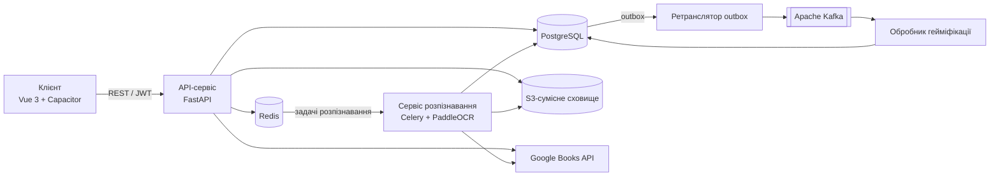
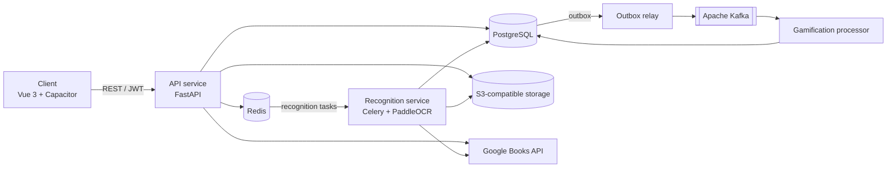

# Thesis Proposal: BookOff

| Параметр | Значення |
|---|---|
| Спеціальність | F2 «Інженерія програмного забезпечення» |
| Освітній рівень | бакалавр |
| Робоча назва продукту | BookOff |
| Версія документа | 1.0 від 21.09.2026 |

Мовні версії: [українська](#українська-версія) · [English](#english-version)

## Українська версія

### 1. Попередня робоча назва

- **Українською:** Подієво-орієнтована система гейміфікованого трекінгу читання з модулем розпізнавання книжкових полиць
- **Англійською:** Event-Driven Gamified Reading Tracking System with a Bookshelf Recognition Module

### 2. Актуальність та проблематика

Сервіси обліку читання призначені для ведення персонального каталогу видань, фіксації прогресу та підтримки регулярності читання. Каталог у таких сервісах зазвичай наповнюється вручну: пошуком видання або скануванням штрихкоду ISBN. Обидва способи потребують окремої дії для кожного примірника, тому перенесення до системи домашньої бібліотеки обсягом у сотні видань є трудомістким. Нотатки, цитати та практичні висновки з прочитаного часто зберігаються в окремих інструментах і не пов’язані з історією читання.

Проєкт спрямовано на автоматизацію наповнення каталогу засобами комп’ютерного зору та на підтримку регулярності читання за допомогою подієвої гейміфікації.

Інженерна складність проблеми зумовлена такими чинниками:

- **Розпізнавання тексту на корінцях книг** виконується в неконтрольованих умовах зйомки: текстові області вузькі й повернуті на ±90°, шрифти та кольори різнорідні, зображення містять відблиски, перспективні спотворення й часткові перекриття, кирилиця поєднується з латиницею. Відкриті набори даних для цієї задачі практично не містять україномовних видань, тому для оцінювання потрібен власний тестовий набір.
- **Результати оптичного розпізнавання містять помилки**, тому ідентифікація видання потребує нечіткого зіставлення з бібліографічними записами та відсіювання хибних збігів за порогом схожості.
- **Обробка одного зображення ресурсомістка** (секунди процесорного часу та сотні мегабайтів оперативної пам’яті), тому не може виконуватися в межах HTTP-запиту: потрібні асинхронна обробка, ізоляція навантаження та горизонтальне масштабування обробників.
- **Стан гейміфікації** (очки досвіду, серії днів читання, досягнення) є похідним від історії дій користувача. Зміна правил нарахування потребує перерахунку стану, а асинхронне виконання — гарантованої доставки подій та ідемпотентності їх обробки.
- **Зовнішнє бібліографічне джерело** (Google Books API) обмежене квотами запитів і має змінну доступність, що потребує кешування та механізмів відмовостійкості.

### 3. Сформована ідея продукту

**Тип системи:** кросплатформна клієнт-серверна система. Клієнтська частина — вебзастосунок та Android-застосунок з єдиною кодовою базою. Серверна частина — подієво-орієнтований модульний моноліт із виділеним асинхронним сервісом комп’ютерного зору.

Система автоматизує наповнення каталогу за фотографією книжкової полиці, фіксує сесії читання та публікує доменні події, на основі яких асинхронно обчислюються показники гейміфікації та аналітики.

**Контейнери системи** (рівень Container моделі C4):

| Контейнер | Технології | Відповідальність |
|---|---|---|
| Клієнт | Vue 3, Capacitor | інтерфейс користувача, доступ до камери, зчитування штрихкодів ISBN |
| API-сервіс | FastAPI | модулі предметної області, автентифікація, REST API, запис доменних подій у таблицю outbox |
| Сервіс розпізнавання | Celery, PaddleOCR, OpenCV | конвеєр комп’ютерного зору, зіставлення з бібліографічними записами |
| Ретранслятор outbox | Python | публікація доменних подій із PostgreSQL до Apache Kafka |
| Обробник гейміфікації | Python | споживання доменних подій, оновлення проєкцій очок досвіду, серій і досягнень |
| Сховища даних | PostgreSQL, Redis, Apache Kafka, S3-сумісне сховище | дані модулів, кеш і черга задач, журнал подій, тимчасові фотографії |

**Ключові архітектурні рішення:**

1. Модульний моноліт із межами модулів за обмеженими контекстами (bounded contexts): identity, catalog, library, reading, gamification, insights, scanner. Кожен модуль володіє власною схемою PostgreSQL і взаємодіє з іншими модулями через явні інтерфейси або доменні події.
2. Обробка зображень виконується асинхронно: API-сервіс перевіряє фотографію, зберігає її в об’єктному сховищі та ставить задачу до черги Celery. Стан задачі описується скінченним автоматом (у черзі → обробка → очікування підтвердження → завершено / помилка); клієнт періодично запитує стан задачі. Сервіс розпізнавання розгортається й масштабується незалежно від API-сервісу.
3. Доменні події (завершення сесії читання, зміна статусу видання, створення нотатки) записуються до таблиці outbox у тій самій транзакції, що й зміна стану (Transactional Outbox), публікуються в Apache Kafka та обробляються ідемпотентними споживачами. Проєкції гейміфікації та аналітики відокремлено від моделі запису (CQRS); їх можна перебудувати повторним програванням журналу подій.
4. Зовнішні залежності (бібліографічні джерела, OCR-рушій, об’єктне сховище) підключаються через порти й адаптери (Ports and Adapters). Це дає змогу порівнювати конфігурації конвеєра розпізнавання в експерименті без зміни доменної логіки.
5. Інтеграцію з Google Books API захищено тайм-аутами, повторними спробами з експоненційною затримкою, механізмом Circuit Breaker і кешуванням у Redis (Cache-Aside); частоту вихідних запитів обмежено відповідно до квоти.
6. Архітектурні рішення фіксуються у форматі ADR, структура системи — діаграмами C4, контракт API — специфікацією OpenAPI.

**Цільові атрибути якості** (попередні значення, уточнюються на етапі проєктування):

- час відповіді API на запити читання даних — p95 ≤ 300 мс за навантаження 100 одночасних віртуальних користувачів (k6);
- тривалість обробки однієї фотографії полиці — p95 ≤ 30 с;
- доставка доменних подій — щонайменше один раз (at-least-once) з ідемпотентною обробкою;
- безпека збірок — образи контейнерів без вразливостей рівнів Critical і High (Trivy), успішне проходження Quality Gate SonarQube;
- покриття тестами доменної логіки серверної частини — щонайменше 70 %.

**Експериментальна складова:**

- оцінювання точності модуля розпізнавання (precision, recall, F1) на власному наборі з 40–60 фотографій (близько 15 полиць × 4 умови зйомки) з кириличними та латинськими корінцями; порівняння версій конвеєра: v0 — зіставлення всього розпізнаного тексту, v1 — групування фрагментів за корінцями, v2 — сегментація корінців;
- навантажувальне тестування (k6): затримки API під навантаженням і залежність пропускної здатності конвеєра розпізнавання від кількості обробників.

**Межі проєкту.** До обсягу роботи не входять публікація власних текстів користувачів, читацькі клуби та обговорення, стрічка новин, взаємодія в реальному часі, застосунок для iOS і навчання власних нейромережевих моделей.

### 4. Ключові функції (Core Features)

1. **Розпізнавання книжкової полиці за фотографією.** Асинхронний конвеєр: детекція текстових областей → нормалізація орієнтації (поворот на ±90°) → оптичне розпізнавання тексту → групування фрагментів за корінцями → нечітке зіставлення з бібліографічними записами → відсіювання результатів за порогом схожості → підтвердження результатів користувачем. Резервний сценарій — зчитування штрихкоду ISBN камерою пристрою.
2. **Каталог видань і персональна бібліотека.** Пошук за назвою, автором та ISBN через адаптер бібліографічних джерел із кешуванням і захистом від відмов зовнішнього API; статуси видань «у планах», «читаю», «прочитано», «покинуто».
3. **Облік сесій читання та аналітика прогресу.** Фіксація сесій (тривалість, діапазон сторінок) через ідемпотентний API; статистика та графіки прогресу на основі проєкцій читання.
4. **Подієва гейміфікація.** Нарахування очок досвіду (XP), серії послідовних днів читання, дерево навичок за жанрами, досягнення та «цвинтар непрочитаного» для покинутих видань. Стан гейміфікації обчислюють споживачі доменних подій. Сповіщення формуються відповідно до обраного тону: класичний мотиватор або іронічний ментор.
5. **Інструменти аналітичного читання.** Нотатки та цитати з тегами; QA-режим для фіксації сюжетних невідповідностей і фактичних помилок у форматі звіту про дефект (Severity, Steps to reproduce); трекер практичних дій за нехудожньою літературою.
6. **Захищений доступ і обробка даних.** Реєстрація та автентифікація (JWT з ротацією refresh-токенів, хешування паролів Argon2id); обмеження частоти запитів до операцій автентифікації та розпізнавання (Token Bucket); перевірка завантажуваних зображень і видалення метаданих EXIF, зокрема геолокації.

### 5. Інструментарій та технологічний стек

| Категорія | Технології |
|---|---|
| Мови програмування | Python, TypeScript, SQL |
| Архітектурні стилі та патерни | Modular Monolith, Event-Driven Architecture, CQRS, Transactional Outbox, Idempotent Consumer, Ports and Adapters, Circuit Breaker, Retry with Exponential Backoff, Cache-Aside, Rate Limiting (Token Bucket) |
| Фреймворки та бібліотеки: серверна частина | FastAPI, Pydantic, SQLAlchemy, Alembic, Celery |
| Фреймворки та бібліотеки: клієнтська частина | Vue 3, Vite, Vue Router, Pinia, Tailwind CSS, Chart.js, Capacitor |
| Комп’ютерний зір | PaddleOCR, OpenCV, RapidFuzz, ZXing |
| Бази даних і сховища | PostgreSQL, Redis, S3-сумісне об’єктне сховище |
| Обмін повідомленнями | Apache Kafka (доменні події), Celery з брокером Redis (задачі розпізнавання) |
| Зовнішні інтеграції | Google Books API, Open Library API (резервне джерело) |
| DevOps і DevSecOps | Git, GitHub Actions, Docker, Docker Compose, GitHub Container Registry, SonarQube Cloud, Trivy, Gitleaks, Dependabot, OpenTofu, Caddy |
| Тестування | pytest, Testcontainers, Vitest, Playwright, k6 |
| Спостережуваність | OpenTelemetry, Prometheus, Grafana, Loki, Jaeger |
| Документування | C4 Model, Mermaid, ADR, OpenAPI, MkDocs |

**Обґрунтування ключових технологій:**

- Python — єдина мова для серверної логіки та конвеєра комп’ютерного зору; FastAPI забезпечує асинхронну обробку запитів і автоматичну генерацію специфікації OpenAPI.
- Поєднання Vue 3 та Capacitor дає змогу отримати вебзастосунок та Android-застосунок з однієї кодової бази.
- PostgreSQL надає ACID-транзакції, необхідні для реалізації Transactional Outbox, а також схеми для ізоляції даних модулів.
- Apache Kafka слугує довговічним журналом доменних подій із можливістю повторного читання; Celery — чергою команд для тривалих задач розпізнавання з повторними спробами та обмеженням часу виконання.
- PaddleOCR надає попередньо навчені моделі детекції та розпізнавання тексту з підтримкою кирилиці, що усуває потребу в навчанні власних моделей.
- SonarQube, Trivy та Gitleaks у конвеєрі GitHub Actions автоматизують контроль технічного боргу, вразливостей залежностей і образів контейнерів, а також витоку секретів.

---

## English version

### 1. Working Title

- **Ukrainian:** Подієво-орієнтована система гейміфікованого трекінгу читання з модулем розпізнавання книжкових полиць
- **English:** Event-Driven Gamified Reading Tracking System with a Bookshelf Recognition Module

### 2. Relevance and Problem Statement

Reading tracking services are designed to maintain a personal catalog of editions, record reading progress, and support a regular reading habit. Such catalogs are usually populated manually, either by searching for an edition or by scanning its ISBN barcode. Both methods require a separate action for each copy, so importing a home library of several hundred books is labor-intensive. Notes, quotes, and practical takeaways from reading are often stored in separate tools and are not linked to the reading history.

The project aims to automate catalog population by means of computer vision and to support reading regularity through event-driven gamification.

The engineering complexity of the problem stems from the following factors:

- **Text recognition on book spines** is performed under uncontrolled shooting conditions: text regions are narrow and rotated by ±90°, fonts and colors vary, images contain glare, perspective distortion, and partial occlusion, and Cyrillic text appears alongside Latin text. Open datasets for this task contain virtually no Ukrainian-language editions, so a custom test set is required for evaluation.
- **OCR output contains errors**, so identifying an edition requires fuzzy matching against bibliographic records and filtering out false matches by a similarity threshold.
- **Processing a single image is resource-intensive** (seconds of CPU time and hundreds of megabytes of RAM) and therefore cannot be performed within an HTTP request: it requires asynchronous processing, workload isolation, and horizontal scaling of workers.
- **Gamification state** (experience points, reading streaks, achievements) is derived from the user's action history. Changing the scoring rules requires recalculating the state, while asynchronous execution requires guaranteed event delivery and idempotent event handling.
- **The external bibliographic source** (Google Books API) is subject to request quotas and variable availability, which calls for caching and fault-tolerance mechanisms.

### 3. Product Concept

**System type:** a cross-platform client-server system. The client side consists of a web application and an Android application built from a single codebase. The server side is an event-driven modular monolith with a dedicated asynchronous computer vision service.

The system automates catalog population from a photo of a bookshelf, records reading sessions, and publishes domain events from which gamification and analytics metrics are computed asynchronously.

**System containers** (C4 model, Container level):

| Container | Technologies | Responsibility |
|---|---|---|
| Client | Vue 3, Capacitor | user interface, camera access, ISBN barcode scanning |
| API service | FastAPI | domain modules, authentication, REST API, writing domain events to the outbox table |
| Recognition service | Celery, PaddleOCR, OpenCV | computer vision pipeline, matching against bibliographic records |
| Outbox relay | Python | publishing domain events from PostgreSQL to Apache Kafka |
| Gamification processor | Python | consuming domain events, updating projections of experience points, streaks, and achievements |
| Data stores | PostgreSQL, Redis, Apache Kafka, S3-compatible storage | module data, cache and task queue, event log, temporary photos |

**Key architectural decisions:**

1. A modular monolith with module boundaries aligned with bounded contexts: identity, catalog, library, reading, gamification, insights, scanner. Each module owns a dedicated PostgreSQL schema and interacts with other modules through explicit interfaces or domain events.
2. Image processing is asynchronous: the API service validates a photo, stores it in object storage, and enqueues a Celery task. The task state is modeled as a finite state machine (queued → processing → awaiting confirmation → completed / failed); the client polls the task state. The recognition service is deployed and scaled independently of the API service.
3. Domain events (reading session completion, edition status change, note creation) are written to the outbox table in the same transaction as the state change (Transactional Outbox), published to Apache Kafka, and processed by idempotent consumers. Gamification and analytics projections are separated from the write model (CQRS) and can be rebuilt by replaying the event log.
4. External dependencies (bibliographic sources, the OCR engine, object storage) are connected via the Ports and Adapters pattern. This makes it possible to compare recognition pipeline configurations in the experiment without changing the domain logic.
5. The Google Books API integration is protected by timeouts, retries with exponential backoff, a circuit breaker, and caching in Redis (Cache-Aside); the outbound request rate is limited according to the quota.
6. Architectural decisions are recorded as ADRs, the system structure is described with C4 diagrams, and the API contract is specified in OpenAPI.

**Target quality attributes** (preliminary values, to be refined at the design stage):

- API response time for data read requests: p95 ≤ 300 ms under a load of 100 concurrent virtual users (k6);
- processing time for a single shelf photo: p95 ≤ 30 s;
- domain event delivery: at-least-once with idempotent processing;
- build security: container images free of Critical and High vulnerabilities (Trivy) and a passed SonarQube Quality Gate;
- test coverage of the server-side domain logic: at least 70%.

**Experimental component:**

- evaluation of the recognition module accuracy (precision, recall, F1) on a custom set of 40–60 photos (about 15 shelves × 4 shooting conditions) with Cyrillic and Latin spines; comparison of pipeline versions: v0 — matching all recognized text, v1 — grouping text fragments by spine, v2 — spine segmentation;
- load testing (k6): API latency under load and the dependence of recognition pipeline throughput on the number of workers.

**Project scope.** Out of scope: publishing user-written texts, reading clubs and discussions, a news feed, real-time interaction, an iOS application, and training custom neural network models.

### 4. Core Features

1. **Bookshelf recognition from a photo.** An asynchronous pipeline: text region detection → orientation normalization (±90° rotation) → optical character recognition → grouping of text fragments by spine → fuzzy matching against bibliographic records → filtering by a similarity threshold → confirmation of results by the user. The fallback scenario is ISBN barcode scanning with the device camera.
2. **Edition catalog and personal library.** Search by title, author, and ISBN through a bibliographic source adapter with caching and protection against external API failures; edition statuses: planned, reading, read, and abandoned.
3. **Reading session tracking and progress analytics.** Recording of sessions (duration, page range) through an idempotent API; progress statistics and charts based on reading projections.
4. **Event-driven gamification.** Experience points (XP), reading streaks, a genre-based skill tree, achievements, and a “graveyard of unread books” for abandoned editions. Gamification state is computed by domain event consumers. Notifications follow the selected tone: a classic motivator or an ironic mentor.
5. **Analytical reading tools.** Tagged notes and quotes; a QA mode for logging plot inconsistencies and factual errors in the form of a defect report (Severity, Steps to reproduce); a tracker of practical actions derived from non-fiction books.
6. **Secure access and data handling.** Registration and authentication (JWT with refresh token rotation, Argon2id password hashing); rate limiting of authentication and recognition requests (Token Bucket); validation of uploaded images and removal of EXIF metadata, including geolocation.

### 5. Tools and Technology Stack

| Category | Technologies |
|---|---|
| Programming languages | Python, TypeScript, SQL |
| Architectural styles and patterns | Modular Monolith, Event-Driven Architecture, CQRS, Transactional Outbox, Idempotent Consumer, Ports and Adapters, Circuit Breaker, Retry with Exponential Backoff, Cache-Aside, Rate Limiting (Token Bucket) |
| Frameworks and libraries: server side | FastAPI, Pydantic, SQLAlchemy, Alembic, Celery |
| Frameworks and libraries: client side | Vue 3, Vite, Vue Router, Pinia, Tailwind CSS, Chart.js, Capacitor |
| Computer vision | PaddleOCR, OpenCV, RapidFuzz, ZXing |
| Databases and storage | PostgreSQL, Redis, S3-compatible object storage |
| Messaging | Apache Kafka (domain events), Celery with a Redis broker (recognition tasks) |
| External integrations | Google Books API, Open Library API (fallback source) |
| DevOps and DevSecOps | Git, GitHub Actions, Docker, Docker Compose, GitHub Container Registry, SonarQube Cloud, Trivy, Gitleaks, Dependabot, OpenTofu, Caddy |
| Testing | pytest, Testcontainers, Vitest, Playwright, k6 |
| Observability | OpenTelemetry, Prometheus, Grafana, Loki, Jaeger |
| Documentation | C4 Model, Mermaid, ADR, OpenAPI, MkDocs |

**Rationale for key technology choices:**

- Python serves as a single language for server-side logic and the computer vision pipeline; FastAPI provides asynchronous request handling and automatic generation of the OpenAPI specification.
- The combination of Vue 3 and Capacitor produces a web application and an Android application from a single codebase.
- PostgreSQL provides the ACID transactions required to implement the Transactional Outbox, as well as schemas for isolating module data.
- Apache Kafka serves as a durable domain event log with replay capability; Celery serves as a command queue for long-running recognition tasks with retries and execution time limits.
- PaddleOCR provides pre-trained text detection and recognition models with Cyrillic support, which eliminates the need to train custom models.
- SonarQube, Trivy, and Gitleaks in the GitHub Actions pipeline automate the control of technical debt, vulnerabilities in dependencies and container images, and secret leaks.
